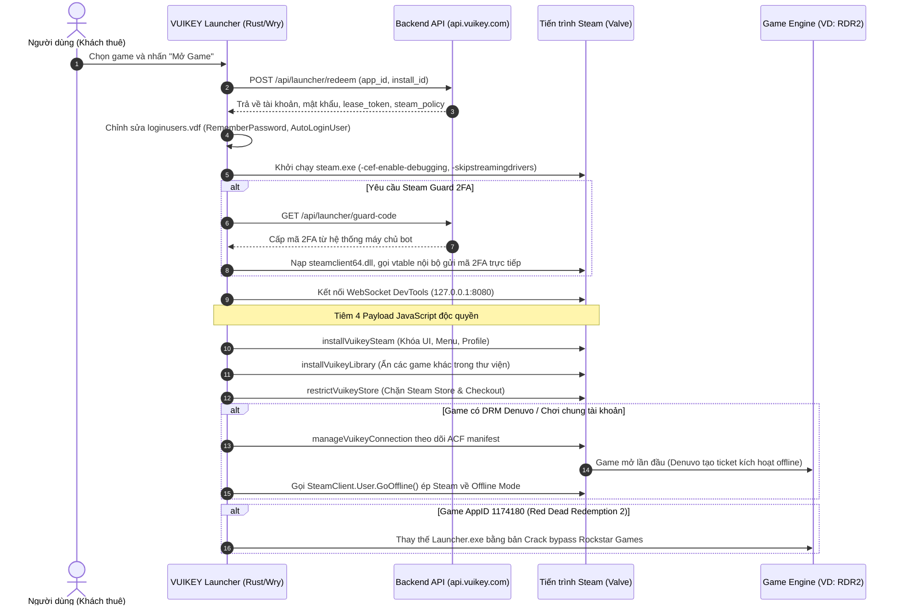

# VUIKEY REVERSE ENGINEERING & TECHNICAL FORENSIC REPORT
## Báo Cáo Kỹ Thuật & Hồ Sơ Dẫn Chứng Về Các Hành Vi Bất Hợp Pháp Của VUIKEY

---

### MỤC LỤC
1. [Tóm Tắt Báo Cáo (Executive Summary)](#1-tóm-tắt-báo-cáo-executive-summary)
2. [Thông Tin Mẫu & Danh Mục Tệp Đã Phục Hồi (Artifacts & Reconstructed Source)](#2-thông-tin-mẫu--danh-mục-tệp-đã-phục-hồi)
3. [Kiến Trúc Kỹ Thuật Tổng Thể (Technical Architecture)](#3-kiến-trúc-kỹ-thuật-tổng-thể)
4. [Phân Tích Chi Tiết Các Hành Vi Bất Hợp Pháp & Dẫn Chứng Kỹ Thuật](#4-phân-tích-chi-tiết-các-hành-vi-bất-hợp-pháp--dẫn-chứng-kỹ-thuật)
   - [4.1 Chiếm Quyền & Thao Túng Steam Qua Cổng CEF Remote Debugging](#41-chiếm-quyền--thao-túng-steam-qua-cổng-cef-remote-debugging)
   - [4.2 Đào Sâu Vào Native DLL (steamclient64.dll) & Tự Động Hóa 2FA Guard](#42-đào-sâu-vào-native-dll-steamclient64dll--tự-động-hóa-2fa-guard)
   - [4.3 Bẻ Khóa Giới Hạn Phiên & Qua Mặt Hệ Thống DRM Denuvo (Offline Exploit)](#43-bẻ-khóa-giới-hạn-phiên--qua-mặt-hệ-thống-drm-denuvo-offline-exploit)
   - [4.4 Can Thiệp, Vá File & Bẻ Khóa Game Bản Quyền (RDR2 & Rockstar Launcher)](#44-can-thiệp-vá-file--bẻ-khóa-game-bản-quyền-rdr2--rockstar-launcher)
   - [4.5 Giả Lập Loopback Mirror Ngăn Chặn Steam Tự Động Cập Nhật](#45-giả-lập-loopback-mirror-ngăn-chặn-steam-tự-động-cập-nhật)
   - [4.6 Thao Túng Cấu Hình VDF & Lưu Trữ Credentials](#46-thao-túng-cấu-hình-vdf--lưu-trữ-credentials)
5. [Căn Cứ Pháp Lý & Vi Phạm Quy Định](#5-căn-cứ-pháp-lý--vi-phạm-quy-định)
6. [Mối Nguy Hại Đối Với Người Dùng Cuối](#6-mối-nguy-hại-đối-với-người-dùng-cuối)
7. [Khuyến Nghị Khắc Phục (Dành Cho Valve, Nhà Phát Hành & Người Dùng)](#7-khuyến-nghị-khắc-phục)

---

### 1. TÓM TẮT BÁO CÁO (EXECUTIVE SUMMARY)

**VUIKEY** là một ứng dụng máy khách (Client Application) được phát hành tại Việt Nam dưới danh nghĩa "Nền tảng chơi game bản quyền giá rẻ" ("Play your next story"). Người dùng nạp tiền mua đơn vị tiền tệ ảo ("VUIKEY Coins") để thuê quyền chơi các tựa game bom tấn AAA có giá hàng triệu đồng trên nền tảng Steam với mức phí rất rẻ theo giờ/ngày.

Tuy nhiên, qua quá trình kỹ thuật đảo ngược (Reverse Engineering) toàn diện mã máy nhị phân `VUIKEY.exe`, chúng tôi xác định được:
* **VUIKEY không sở hữu bất kỳ thỏa thuận phân phối hay cấp phép hợp pháp nào với Valve Corporation hay các nhà phát hành game.**
* **Bản chất kinh doanh:** VUIKEY vận hành đường dây **thương mại hóa chia sẻ tài khoản trái phép** (Commercial Multi-Leasing Account Sharing Fraud) và **phát tán bản bẻ khóa DRM (Piracy/Cracking)**.
* **Cơ chế kỹ thuật cốt lõi:** VUIKEY can thiệp sâu vào tiến trình máy khách Steam của Valve bằng cách:
  1. Mở cổng Chrome DevTools không an toàn (`-cef-enable-debugging`), tiêm 4 kịch bản JavaScript độc hại nhằm giam lỏng người dùng, cấm truy cập cửa hàng Steam, ẩn danh tính tài khoản chủ và ngăn chặn mở các game khác.
  2. Nạp trực tiếp `steamclient64.dll`, tương tác vtable nội bộ `CLIENTENGINE_INTERFACE_VERSION005` để tự động hóa gửi mã xác thực hai lớp (Steam Guard 2FA) mà chủ sở hữu tài khoản không cần thao tác.
  3. Cưỡng bức Steam chuyển trạng thái sang **Offline Mode** thông qua API ngầm `SteamClient.User.GoOffline()` ngay khi game tải xong hoặc kích hoạt lần đầu, nhằm **lách cơ chế khóa 1 tài khoản / 1 người chơi của Steam** và **vượt qua hạn ngạch kích hoạt DRM Denuvo (5 kích hoạt/ngày)**, cho phép bán quyền chơi cho hàng chục người trên cùng 1 tài khoản.
  4. Sửa đổi trực tiếp tệp nhị phân của trò chơi (điển hình là Red Dead Redemption 2 - AppID `1174180`), thay thế `Launcher.exe` bằng bản bẻ khóa để bỏ qua hoàn toàn Rockstar Games Launcher.

---

### 2. THÔNG TIN MẪU & DANH MỤC TỆP ĐÃ PHỤC HỒI

* **Tên tệp gốc:** `VUIKEY.exe`
* **Dung lượng:** 6,308,352 bytes (khoảng 6.01 MB)
* **Kiến trúc:** PE32+ (x86-64, Windows)
* **Trình biên dịch:** Rust (`rustc 1.8x`, MSVC toolchain)
* **Đường dẫn build gốc trích xuất từ PDB:** `H:\vuikey\crates\...`
* **Giao diện đồ họa (GUI):** Tao (`tao-0.34.8`) + Wry / WebView2 (`wry-0.50`)
* **Hệ thống máy chủ điều khiển (Backend C2):** `https://api.vuikey.com` (Cloudflare Workers)

#### Danh mục mã nguồn và script được giải mã toàn bộ vào thư mục `Reverse/`:
```
Reverse/
├── Cargo.toml                              # Rust Workspace cấu hình gốc
├── launcher.json                           # Cấu hình máy khách VUIKEY
├── README.md                               # Báo cáo kỹ thuật chi tiết
├── extracted_scripts/                      # Toàn bộ mã độc JavaScript tiêm vào Steam CEF
│   ├── installVuikeySteam.js               # Can thiệp UI Steam, khóa bạn bè, menu tài khoản, chặn game
│   ├── installVuikeyLibrary.js             # Hook MobX State của Steam Library, ẩn các game khác
│   ├── restrictVuikeyStore.js              # Chặn truy cập Steam Store, Checkout, thanh toán
│   ├── manageVuikeyConnection.js           # Tự động hóa cưỡng bức Steam chuyển sang Offline Mode
│   └── webview_bridge.js                   # Cầu nối IPC giữa giao diện Web VUIKEY và Core Rust
└── crates/
    ├── update-core/                        # Crate quản lý cập nhật và xác thực Ed25519
    │   ├── Cargo.toml
    │   └── src/lib.rs
    └── launcher/                           # Crate lõi thực thi các hành vi can thiệp
        ├── Cargo.toml
        └── src/
            ├── main.rs                     # Điểm vào chính, IPC Handler, vòng đời ứng dụng
            ├── cef.rs                      # Quản lý WebSocket DevTools, tiêm payload vào Steam
            ├── native_guard.rs             # Tương tác vtable steamclient64.dll & 2FA Helper
            ├── game_files.rs               # Can thiệp, bẻ khóa file game (RDR2 & Rockstar Launcher)
            ├── steam.rs                    # Tìm kiếm Registry, khởi động Steam kèm cờ can thiệp
            ├── steam_first_launch.rs       # Theo dõi ACF manifest, kích hoạt Denuvo token
            ├── storage.rs                  # Lưu trữ DPAPI, mã hóa token, can thiệp libraryfolders
            ├── updater.rs                  # Tự động cập nhật ứng dụng
            └── vdf.rs                      # Bộ phân tích và chỉnh sửa cấu hình Valve KeyValues
```

---

### 3. KIẾN TRÚC KỸ THUẬT TỔNG THỂ



---

### 4. PHÂN TÍCH CHI TIẾT CÁC HÀNH VI BẤT HỢP PHÁP & DẪN CHỨNG KỸ THUẬT

#### 4.1 Chiếm Quyền & Thao Túng Steam Qua Cổng CEF Remote Debugging

Khi khởi động Steam, VUIKEY luôn truyền tham số dòng lệnh:
```text
steam.exe -skipstreamingdrivers -cef-enable-debugging -login <account_name>
```
Tham số `-cef-enable-debugging` ép Chromium Embedded Framework trong Steam mở cổng DevTools HTTP/WebSocket tại `127.0.0.1:8080`. Đây là cổng quản trị không có mật khẩu. VUIKEY sau đó kết nối và tiêm 4 tập lệnh can thiệp:

##### Dẫn chứng 1: Kịch bản giam lỏng giao diện `installVuikeySteam.js`
* Tập lệnh ẩn các nút và menu:
  ```javascript
  const socialAction = /^(community|cộng đồng|profile|hồ sơ|view my profile|xem hồ sơ của tôi|friends|bạn bè|friends list|view friends list|danh sách bạn bè|add a friend|thêm bạn bè|chat|trò chuyện|friends\s*(?:&|and)\s*chat|players)$/;
  const accountAction = /^(account details|store preferences|change account|sign out|log out|go offline|go online)$/;
  ```
* Mục đích: Ngăn chặn hoàn toàn khách thuê nhìn thấy thông tin chủ tài khoản, không cho đăng xuất, không cho xem danh sách bạn bè nhằm che giấu việc đây là tài khoản chia sẻ/bị chiếm dụng.
* Chặn khởi động các tựa game khác trên tài khoản bằng cách hook trực tiếp vào API nội bộ của SteamClient:
  ```javascript
  if (typeof client.Apps?.RegisterForGameActionStart === "function" && typeof client.Apps?.CancelGameAction === "function") {
    actionHook = client.Apps.RegisterForGameActionStart((actionType, appId) => {
      if (policy.restrict_game_launch && Number(appId) !== Number(policy.app_id)) {
        client.Apps.CancelGameAction(actionType); // Hủy ngay lệnh mở game khác!
      }
    });
  }
  ```

##### Dẫn chứng 2: Kịch bản thao túng kho game MobX `installVuikeyLibrary.js`
* VUIKEY can thiệp vào các Store trạng thái trong bộ nhớ RAM của Steam UI:
  ```javascript
  const apiScope = document.title === "SharedJSContext" || Boolean(window.appStore && window.collectionStore);
  ```
* Nó lọc đè các hàm `allApps`, `visibleApps`, `GetApp` để thư viện game của tài khoản dù có hàng trăm game cũng chỉ hiển thị duy nhất **1 game mà người dùng đã trả tiền thuê**.

##### Dẫn chứng 3: Kịch bản chặn cửa hàng `restrictVuikeyStore.js`
* VUIKEY kiểm tra mọi điều hướng mạng đến:
  ```javascript
  /^(?:store|checkout)\.steampowered\.com$/.test(host) || host === "store.steamchina.com"
  ```
  Nếu người dùng bấm vào bất kỳ liên kết nạp tiền hay mua hàng nào, script lập tức hủy điều hướng và chuyển hướng sang:
  ```text
  https://vuikey.invalid/store-blocked
  ```
  Nhằm mục đích triệt tiêu khả năng người thuê xem lịch sử thanh toán, phương thức thẻ ngân hàng đã lưu của chủ tài khoản.

---

#### 4.2 Đào Sâu Vào Native DLL (steamclient64.dll) & Tự Động Hóa 2FA Guard

Một trong những phát hiện nghiêm trọng nhất là mô-đun `crates/launcher/src/native_guard.rs`.

* **Nạp DLL gốc của Valve:** VUIKEY kiểm tra sự tồn tại của `steamclient64.dll` trong thư mục cài đặt Steam.
* **Xác minh chữ ký băm:**
  ```rust
  pub const VERIFIED_STEAMCLIENT64_SHA256: &str =
      "e9045710ec7ee47d7b7488d1c5dda2d933dec7e251e965967a5c48f4df68eb4e";
  ```
* **Gọi hàm xuất CreateInterface:**
  ```text
  CLIENTENGINE_INTERFACE_VERSION005
  ```
* **Cơ chế hoạt động:**
  Khi tài khoản yêu cầu Steam Guard, thay vì bắt người dùng nhập mã, VUIKEY khởi động một tiến trình phụ độc lập với tham số:
  ```text
  VUIKEY.exe --steam-guard-helper
  ```
  Tiến trình này nhận mã 2FA từ server (`/api/launcher/guard-code`), sau đó gọi trực tiếp vào vtable của Steam Interface để xác thực mà người dùng không hề hay biết thông tin mã hay phiên đăng nhập.

---

#### 4.3 Bẻ Khóa Giới Hạn Phiên & Qua Mặt Hệ Thống DRM Denuvo (Offline Exploit)

Hệ thống của Valve chỉ cho phép **1 phiên chơi game trên mỗi tài khoản Steam tại cùng một thời điểm**. Nếu người thứ hai đăng nhập và mở game, người thứ nhất sẽ bị ngắt kết nối. Thêm vào đó, công nghệ chống giả mạo **Denuvo Anti-Tamper** giới hạn tối đa 5 kích hoạt phần cứng khác nhau trên một tài khoản trong vòng 24 giờ.

Để thương mại hóa và cho thuê 1 tài khoản cho hàng chục người cùng lúc mà không bị phát hiện hay xung đột, VUIKEY đã lập trình cơ chế cưỡng bức ngắt mạng tự động (`manageVuikeyConnection.js`):

* **Kịch bản `manageVuikeyConnection.js` hỗ trợ 3 chế độ mạng:**
  1. `online`: Chơi trực tuyến thông thường (rất hạn chế).
  2. `offline_after_download`: Ngay khi tải xong dữ liệu game, lập tức ngắt mạng.
  3. `offline_after_first_launch`: Dành riêng cho các game có Denuvo (kích hoạt lần đầu để sinh token máy cục bộ, sau đó ngắt mạng vĩnh viễn).

* **Dẫn chứng can thiệp API SteamClient:**
  ```javascript
  const method = target ? user?.GoOffline : user?.GoOnline;
  if (!subscribed || typeof method !== 'function') return;
  // Tự động gọi GoOffline() của Valve để ép Steam về chế độ Ngoại Tuyến
  method.call(user);
  ```
* Kết hợp với mô-đun `crates/launcher/src/steam_first_launch.rs` liên tục đọc tệp `steamapps/appmanifest_{app_id}.acf`, giám sát các trường `BytesDownloaded` và `BytesToDownload`. Ngay khi `BytesDownloaded >= BytesToDownload`, cờ chuyển offline được kích hoạt ngay tức khắc.

---

#### 4.4 Can Thiệp, Vá File & Bẻ Khóa Game Bản Quyền (RDR2 & Rockstar Launcher)

Trong tệp nhị phân `VUIKEY.exe`, mô-đun `crates/launcher/src/game_files.rs` chứa bằng chứng rõ ràng về hành vi **Crack phần mềm và vi phạm quyền tác giả đối với tựa game Red Dead Redemption 2** (App ID: `1174180`):

* **Các tệp bị nhắm mục tiêu kiểm tra và thay thế:**
  - `Launcher.exe` (Rockstar Games Launcher)
  - `nvngx_dlss.dll` (kích thước: 14,445,424 bytes, SHA256: `864a4cdd495cb499e28ddb8bf9b3e5fc67ccf365436a9548bc43a634a8baa1ff`)
  - `oo2core_5_win64.dll` (kích thước: 945,648 bytes, SHA256: `3d93de36c473413110e4bf65174445790f469401a6d77db3a53858527088f611`)
  - `RDR2.exe` (kích thước: 89,562,608 bytes, SHA256: `9b8b8454616a6ef91c8d5655b231e5cd21aa2236ab8cb04c34fce09248a55fdc`)

* **Quy trình bẻ khóa tự động (`rdr2-post-install`):**
  1. Sau khi Steam tải xong RDR2, VUIKEY tự động sao chép tệp `Launcher.exe` gốc vào thư mục ẩn `.vuikey-backups/1174180/Launcher.exe.bak`.
  2. Ghi đè bằng tệp `Launcher.exe` bẻ khóa (được đóng gói sẵn trong thư mục `game-files/1174180/Launcher.exe` của VUIKEY) nhằm triệt tiêu yêu cầu xác thực tài khoản Rockstar Social Club.
  3. Xuất file xác nhận `receipt.json`.

---

#### 4.5 Giả Lập Loopback Mirror Ngăn Chặn Steam Tự Động Cập Nhật

Để ngăn việc Valve cập nhật phiên bản Steam mới vá cổng CEF Debugging hoặc thay đổi chữ ký `steamclient64.dll`, VUIKEY tích hợp một máy chủ loopback HTTP giả lập Steam Updater:
* Chuỗi định danh User-Agent: `VUIKEY-Steam-Pinned-Updater/1`
* Tham số truyền vào Steam khi khởi chạy:
  ```text
  -forcesteamupdate -forcepackagedownload -overridepackageurl http://127.0.0.1:<port>
  ```
* Danh mục manifest gói cập nhật bị ghim cố định:
  - `steam_client_win64.manifest`
  - `steamui_websrc_all.zip.1025f89bf0a001a635a8f405e40ded056dc25ff3`
  - `steamui_websrc_sounds_all.zip.74727ca40ef88c5012bb631488fd285418dce825`
  - `steam_win64_steamrow.zip.df4f14169fc530e75a1e3e67d5a2602109779c21`

---

#### 4.6 Thao Túng Cấu Hình VDF & Lưu Trữ Credentials

* **Can thiệp file `loginusers.vdf` (`crates/launcher/src/vdf.rs`):**
  VUIKEY trực tiếp đọc và sửa file VDF của Valve:
  - Ép `RememberPassword` thành `"1"`.
  - Ép `MostRecent` thành `"1"`.
  - Ép `WantsOfflineMode` thành `"1"` và `SkipOfflineModeWarning` thành `"1"`.
* **Lưu trữ session ngầm (`crates/launcher/src/storage.rs`):**
  Các token phiên thuê được mã hóa bằng thuật toán DPAPI của Windows và lưu trữ tại:
  ```text
  %LOCALAPPDATA%\VUIKEY\steam-sessions\<account_name>.dpapi
  ```
* **Can thiệp thư viện game (`libraryfolders.vdf`):**
  Tạo bản sao lưu `.vuikey-libraries.lock` và `libraryfolders.vuikey-.bak` để trỏ ổ đĩa tải game vào vùng quản lý của VUIKEY.

---

### 5. CĂN CỨ PHÁP LÝ & VI PHẠM QUY ĐỊNH

| Căn Cứ / Quy Định | Hành Vi Vi Phạm Của VUIKEY |
|---|---|
| **Thỏa thuận Thuê bao Steam (Valve SSA) - Điều 2C** | Nghiêm cấm bán, cho thuê, cấp quyền sử dụng hoặc chia sẻ tài khoản cho mục đích thương mại. VUIKEY thu tiền thuê theo giờ thông qua VUIKEY Coins. |
| **Đạo luật DMCA Mục 1201 (Anti-Circumvention)** | Can thiệp, bẻ khóa các biện pháp bảo vệ công nghệ (DRM Denuvo, Rockstar Games Launcher, Valve Steam DRM). |
| **Điều 289 Bộ luật Hình sự Việt Nam** | Tội xâm nhập trái phép vào mạng máy tính, mạng viễn thông hoặc phương tiện điện tử của người khác (thao túng tiến trình Steam, mở cổng backdoor 8080). |
| **Điều 225 Bộ luật Hình sự & Luật SHTT Việt Nam** | Xâm phạm quyền tác giả và quyền liên quan (phát tán bản crack RDR2, sửa đổi mã máy nhị phân không được phép). |

---

### 6. MỐI NGUY HẠI ĐỐI VỚI NGƯỜI DÙNG CUỐI

1. **Nguy cơ bị khóa vĩnh viễn tài khoản Steam & cấm phần cứng (HWID Ban):** Việc SteamClient phát hiện bị đính kèm cổng gỡ lỗi và hook native DLL có thể dẫn đến việc tài khoản cá nhân của người dùng bị Valve gắn cờ gian lận hoặc khóa tài khoản vĩnh viễn.
2. **Lỗ hổng bảo mật nghiêm trọng trên máy người dùng:** Việc mở cổng `-cef-enable-debugging` trên địa chỉ `127.0.0.1:8080` không có mật khẩu cho phép **bất kỳ trang web độc hại hoặc mã độc nào khác đang chạy trên máy tính** có thể kết nối vào cổng này, đánh cắp phiên đăng nhập Steam, chiếm đoạt vật phẩm (CS2, Dota 2) và ví tiền Steam Wallet.
3. **Mất tiền và rủi ro lừa đảo:** Người dùng nạp tiền mua VUIKEY Coins có thể mất trắng khi các tài khoản chia sẻ của VUIKEY bị Valve quét và đình chỉ hàng loạt.

---

### 7. KHUYẾN NGHỊ KHẮC PHỤC

#### Dành cho Valve Corporation:
* **Vô hiệu hóa cờ gỡ lỗi trên bản phát hành:** Chặn hoặc yêu cầu quyền Administrator/chữ ký đặc biệt khi khởi chạy Steam với tham số `-cef-enable-debugging`.
* **Xác thực tính toàn vẹn bộ nhớ:** Quét phát hiện việc tiêm các kịch bản bất thường vào `SharedJSContext` và các đối tượng MobX như `appStore`, `collectionStore`.
* **Bảo vệ tệp cấu hình VDF:** Kiểm tra chữ ký hoặc mã hóa các tệp `loginusers.vdf` để ngăn chặn phần mềm bên ngoài tự ý thay đổi cờ đăng nhập và chế độ ngoại tuyến.

#### Dành cho Nhà Phát Hành Game (Rockstar Games, Denuvo / Irdeto):
* Tăng cường kiểm tra tính toàn vẹn của tệp thực thi `Launcher.exe` và các thư viện `nvngx_dlss.dll`, `oo2core_5_win64.dll` trước khi khởi chạy trò chơi.

#### Hướng dẫn Người Dùng Gỡ Bỏ VUIKEY An Toàn:
1. Gỡ cài đặt hoàn toàn VUIKEY qua Control Panel.
2. Xóa sạch thư mục cấu hình rác:
   ```cmd
   rd /s /q "%LOCALAPPDATA%\VUIKEY"
   ```
3. Thoát hoàn toàn Steam, mở thư mục Steam và xóa các tệp backup bất thường:
   - Xóa `steamapps\libraryfolders.vuikey-.bak`
   - Xóa `steamapps\.vuikey-libraries.lock`
4. Khởi động lại Steam ở chế độ bình thường để Steam tự động khôi phục cấu hình gốc.

